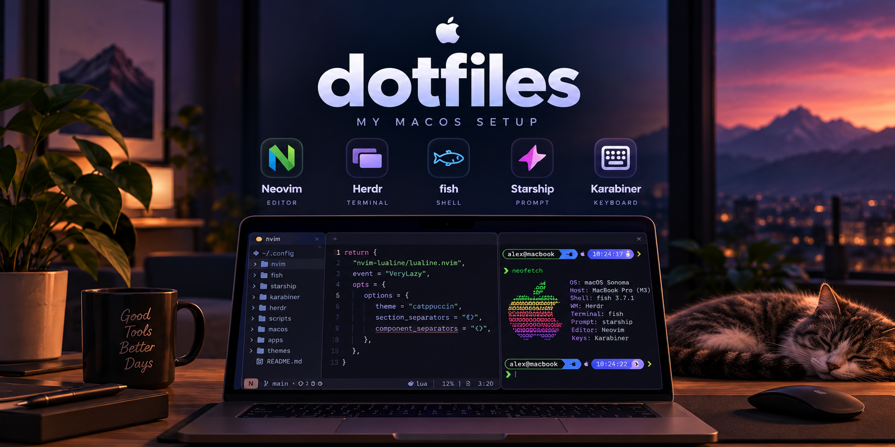

<p align="center">
  
</p>

<h1 align="center">dotfiles</h1>

<p align="center">My macOS dotfiles, managed with <a href="https://www.chezmoi.io/">chezmoi</a>.</p>

## What's inside

- **fish** shell: zoxide, fzf.fish, git abbreviations
- **neovim** config (lazy.nvim)
- **ghostty** and **kitty** terminals
- **herdr** agent multiplexer
- **lazygit**, **gh** CLI
- **karabiner** key remaps
- **starship** prompt
- **Brewfile** with all packages (brew, casks, go tools)
- **git** and **ssh** config
- **Claude Code**: settings, `CLAUDE.md`, [claude-hud](https://github.com/jarrodwatts/claude-hud) statusline

## Setup on a new Mac

1. Install [Homebrew](https://brew.sh) and chezmoi:

   ```sh
   /bin/bash -c "$(curl -fsSL https://raw.githubusercontent.com/Homebrew/install/HEAD/install.sh)"
   brew install chezmoi
   ```

2. Apply the dotfiles. `init` asks for the git name, email and commit signing key for this machine (work or personal), then `brew bundle` installs everything from the Brewfile:

   ```sh
   chezmoi init --apply https://github.com/kryptamine/dotfiles
   ```

3. Make fish the login shell:

   ```sh
   echo /opt/homebrew/bin/fish | sudo tee -a /etc/shells
   chsh -s /opt/homebrew/bin/fish
   ```

4. Copy SSH keys into `~/.ssh` (they are not in the repo). `~/.ssh/config` expects:
   - `id_rsa` for `github.com-personal` (this repo, personal projects)
   - `gh-enterprise` for `github.com` (work)

   Commits are signed with the SSH key `init` asks for (default `~/.ssh/id_rsa.pub`). Add it on GitHub as a **Signing key** (Settings → SSH and GPG keys) so commits show as Verified.

5. Log in to GitHub CLI: `gh auth login`. Accounts are per machine, `hosts.yml` is not synced.

6. Switch the repo to SSH so you can push, and enable the lint hook:

   ```sh
   cd ~/.local/share/chezmoi
   git remote set-url origin git@github.com-personal:kryptamine/dotfiles.git
   git config core.hooksPath .githooks
   ```

7. Open `nvim`: lazy.nvim installs plugins on first launch, mason installs LSP servers and formatters.

## Day-to-day

chezmoi runs in symlink mode: most files in `~` link straight into the repo, so editing `~/.config/fish/config.fish` edits the repo. Templates (`~/.gitconfig`) are real files, edit them with `chezmoi edit ~/.gitconfig`.

| Task | Command |
|---|---|
| Start tracking a new config | `chezmoi add ~/.config/foo` |
| Pull and apply changes from GitHub | `chezmoi update` |
| See what `apply` would change | `chezmoi diff` |
| Go to the repo | `chezmoi cd` |
| Add a package | add it to `~/.Brewfile`, then `chezmoi apply` reruns `brew bundle` |
| Add a fish plugin | `fisher install <repo>`, then `chezmoi add` the new files |

## Claude Code

`~/.claude/settings.json` is a real file, not a symlink: `chezmoi apply` merges the shared base from `.chezmoitemplates/claude-settings.json` into it and keeps per-machine keys (herdr hooks, work plugins, `autoMode`). A setting changed with `/config` stays local until you copy it into the base.

On a new Mac, run `/claude-hud:setup` once in Claude Code to install the statusline launcher, then `chezmoi apply ~/.claude/settings.json` to restore the portable statusline command.

## Fish

- `z <dir>` jumps to a frecent directory, `zi` picks one with fzf
- `Ctrl+R` history, `Ctrl+Alt+F` files, `Ctrl+Alt+L` git log, `Ctrl+Alt+S` git status, `Ctrl+Alt+P` processes, `Ctrl+V` variables
- Abbreviations expand on space: `g` git, `gco` checkout, `gd` diff, `gp` push, `gl` pull, `gs` status, `lg` lazygit, `v` nvim, `cz` chezmoi

## Linting

The pre-commit hook checks fish (`fish_indent`), Lua (`stylua`) and shell (`shellcheck`). Run `.githooks/pre-commit` to check by hand.
